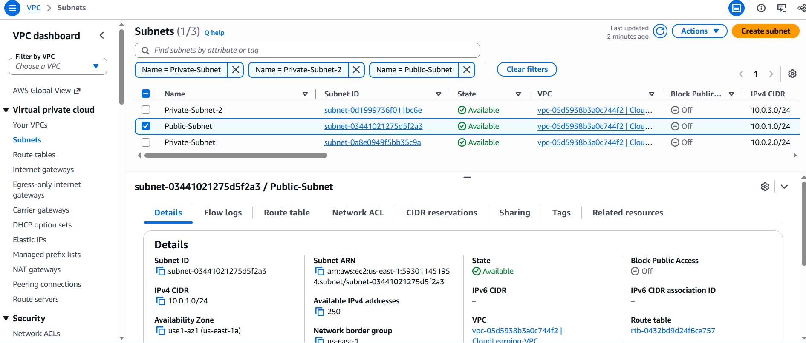
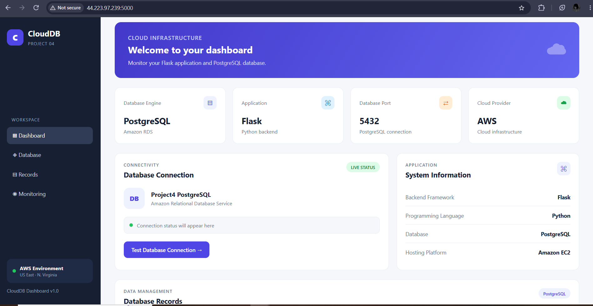
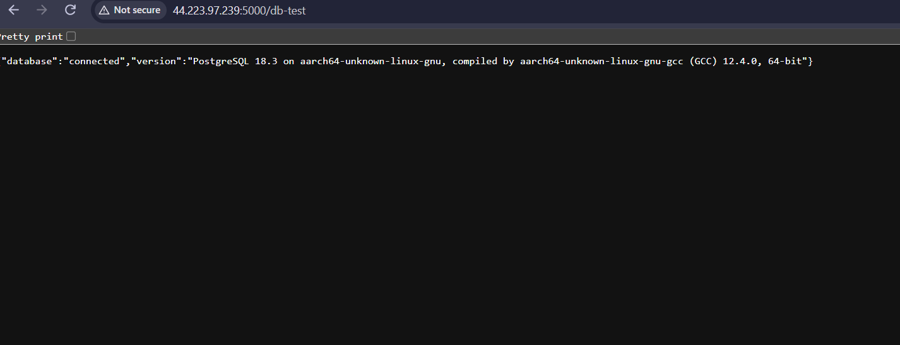
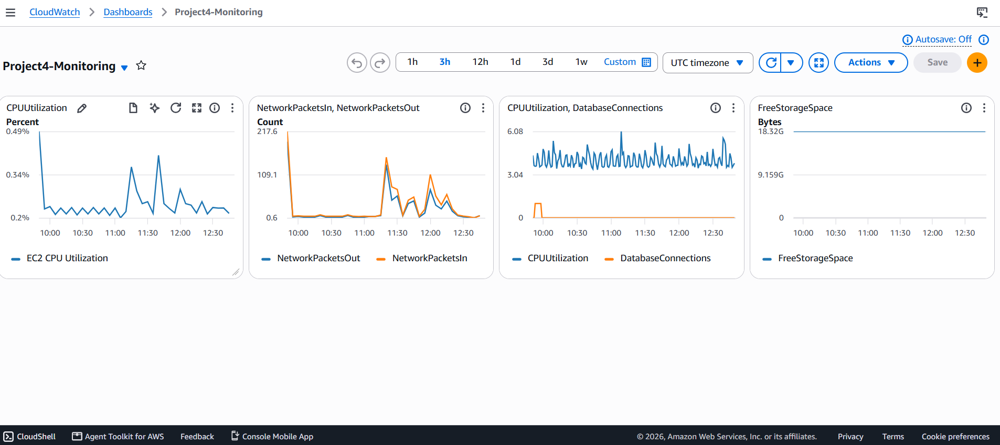

# AWS Flask Application with RDS PostgreSQL & CloudWatch Monitoring

## Project Overview

This project demonstrates deploying a Python Flask web application on Amazon EC2, connecting it to an Amazon RDS PostgreSQL database hosted in private subnets, and monitoring AWS resources using Amazon CloudWatch.

## Architecture

The project uses a custom Amazon VPC with the following network configuration:

- **VPC CIDR:** `10.0.0.0/16`
- **Public Subnet:** `10.0.1.0/24`
- **Private Subnet 1:** `10.0.2.0/24`
- **Private Subnet 2:** `10.0.3.0/24`

### Architecture Components

1. Amazon VPC provides an isolated network environment.
2. Public subnet hosts the EC2 instance.
3. Private subnets host the RDS PostgreSQL database.
4. Internet Gateway provides internet connectivity to the public subnet.
5. EC2 hosts the Flask web application.
6. RDS stores relational database information.
7. CloudWatch monitors AWS resources through metrics, dashboards, and alarms.

## AWS Services Used

- Amazon EC2
- Amazon VPC
- Amazon RDS (PostgreSQL)
- Amazon CloudWatch
- Internet Gateway
- Security Groups

## Application Features

The Flask application includes the following routes:

- `/` — Main application dashboard.
- `/health` — Application health-check endpoint.
- `/db-test` — Tests the connection to the PostgreSQL database.

Other implementation details:

- Python Flask application hosted on EC2.
- PostgreSQL database connectivity using `psycopg2`.
- Environment variables managed using `python-dotenv`.
- HTML templates and CSS for the web interface.

## Database Configuration

- Database Engine: PostgreSQL
- Database Name: `projectdb`
- Port: `5432`
- Database Service: Amazon RDS

The RDS instance is deployed in private subnets. Its security group allows PostgreSQL traffic on port 5432 only from the EC2 security group.

The database connection was tested successfully through the Flask `/db-test` route.

## CloudWatch Monitoring

Created a CloudWatch dashboard named `Project4-Monitoring`.

### Monitored Metrics

- EC2 CPU Utilization
- EC2 Network Packets
- RDS CPU Utilization
- RDS Database Connections
- RDS Free Storage Space

### CloudWatch Alarms

Configured two CloudWatch alarms:

- EC2 CPU utilization above 70%.
- RDS CPU utilization above 70%.

## Project Screenshots

### 1. VPC and Subnets



### 2. Flask Application



### 3. RDS Database Connection



### 4. CloudWatch Monitoring Dashboard



## Project Structure

```text
project4/
├── app.py
├── requirements.txt
├── .env.example
├── .gitignore
├── templates/
│   └── index.html
└── static/
    └── style.css
```

## Setup Instructions

### 1. Clone the Repository

```bash
git clone https://github.com/muqadduskhan/aws-flask-rds-cloudwatch.git
cd aws-flask-rds-cloudwatch
```

### 2. Create a Virtual Environment

```bash
python -m venv venv
```

Activate it:

```bash
source venv/bin/activate
```

### 3. Install Dependencies

```bash
pip install -r requirements.txt
```

### 4. Configure Environment Variables

Create a `.env` file using `.env.example` as a reference.

### 5. Run the Application

```bash
python app.py
```

## Security Practices

- RDS deployed in private subnets.
- Database access restricted through security groups.
- PostgreSQL access allowed only from the EC2 security group.
- Database credentials stored in environment variables.
- `.env` excluded from Git using `.gitignore`.
- `.env.example` contains placeholder configuration only.

## Challenges and Learning Outcomes

During this project, I gained hands-on experience with:

- Creating and configuring a custom VPC.
- Working with public and private subnets.
- Configuring Internet Gateway and route tables.
- Deploying a Flask application on Amazon EC2.
- Connecting EC2 to an RDS PostgreSQL database.
- Configuring security groups for controlled database access.
- Troubleshooting application and database connectivity.
- Creating CloudWatch dashboards and alarms.
- Using Git and GitHub for project version control.

## Limitations and Future Improvements

- Replace Flask's development server with a production WSGI server.
- Implement dynamic dashboard data.
- Add database records and display them in the application.
- Improve application security and monitoring.
- Explore automated deployment using CI/CD.


